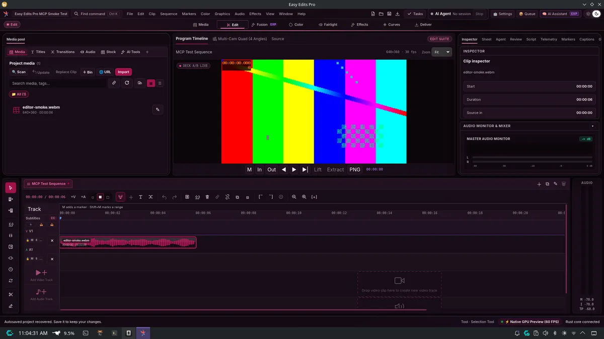
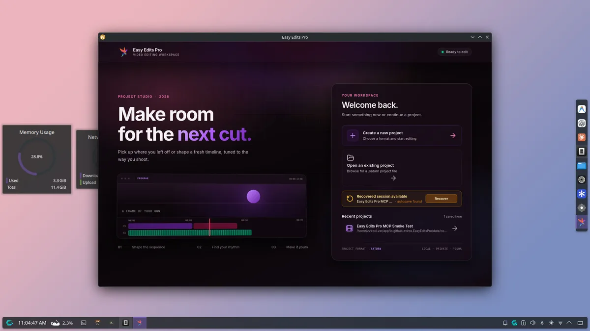

*The beta workspace: media pool on the left, program monitor and inspector above, and the multitrack Edit timeline below. Screenshot from the current Easy Edits Pro checkout.*

> *First-hand maintainer account. Release dates, command counts, and feature claims come from the [Easy Edits Pro repository](https://github.com/zvirox/easy-edits-pro), its [changelog](https://github.com/zvirox/easy-edits-pro/blob/main/CHANGELOG.md), and published [release notes](https://github.com/zvirox/easy-edits-pro/releases). No sponsorship or third-party claims are included.*

## Easy Edits Pro: From First Alpha to First Beta

The Easy Edits Pro alpha-to-beta journey took 22 days. The repository was created on 8 October 2026, the first alpha tag (`v0.1.0-alpha.1`) was published on 23 October, and the first beta (`v0.1.3-beta.1`) followed on 14 November. Between those dates the project shipped 34 alpha releases, then one beta. This article explains what changed in that window, what the beta actually contains, and where the limits still are.

Easy Edits Pro is an open-source Linux video editor developed under the codename **Project Saturn**. It is built with a Rust core, a Tauri desktop shell with a React interface, and GStreamer for rendering. The code is AGPL-3.0 licensed in the [GitHub repository](https://github.com/zvirox/easy-edits-pro), and the maintained product summary lives on the [Easy Edits Pro project page](/projects/eep/).

### The Starting Point: An Alpha With a Real Engine

The first alpha was not a mock-up. The repository README describes a working Rust core that owns project, timeline, task sheet, and review state, with the desktop UI, CLI, MCP server, and control server sending commands to that core.

| Layer | Role in the editor |
|-------|--------------------|
| `saturn-core` and command crates | Project, timeline, review, and task sheet state; versioned commands |
| Tauri desktop app | Native Linux window, React workspace, docks, and panels |
| GStreamer render path | MP4 and WebM export, subject to installed plugins |
| `saturn-mcp` | Inspect projects, run editor commands, manage render jobs |
| CLI and control server | Scriptable access and a Unix-socket desktop bridge |

The [command catalogue](https://github.com/zvirox/easy-edits-pro/blob/main/docs/COMMANDS.md) and [parity report](https://github.com/zvirox/easy-edits-pro/blob/main/docs/PARITY.md) are the project's source of truth for shipped surface. The v0.1.2-alpha.7 release notes record 489 shipped commands across 13 profiles; the current checkout reports 492. Those numbers describe shipped commands, not completed reference-editor feature parity.

### Phase 1 — Editing Basics and Command Parity (Late October)

The first alpha series (`v0.1.0-alpha.1` through `v0.1.0-alpha.26`, published 23–27 October) established the editing loop: create, open, save, and recover versioned projects; import and organise local media; place clips on a timeline; split, trim, move, and scrub; and export through GStreamer.

This phase was mostly engineering groundwork rather than visual polish. Each alpha added or corrected commands, and the generated catalogue and parity documents were kept in sync with the code. By `v0.1.1-alpha.1` on 27 October, the project had a stable base for the more ambitious agent-first work that followed.

### Phase 2 — Agent-First Editing Enters the Core (Early November)

The `v0.1.2` alphas changed the product's direction. Feature packets AF1 through AF6 moved AI assistance from an external experiment into the editor core and interface.

| Packet | What it added |
|--------|---------------|
| AF1–AF2 | Tool profiles, a three-tier permission model (`Read`, `Edit`, `Filesystem`), actor identity, viewport isolation, clip and region locks, and a change journal with rollback-safe batches |
| AF3 | `verify.run`, a read-only empirical check for LUFS, true peak, silence, clipping, crushed blacks, frozen frames, caption safe area, and provenance |
| AF4 | Per-edit rationale and confidence, human-owned briefs, and durable provenance when a person corrects an agent edit |
| AF5 | Origin tracking for media-derived text, with untrusted payload fencing against prompt-injection style escalation |
| AF6 | Status chip, one-second Stop control, Agent Card, Review Card, permission prompts, and settings for agent sessions |

Packet 5.2 added React 19 co-editing panels: a branch diff ribbon above the timeline, 60 FPS video scopes drawn on raw canvas, a word-level transcript and script-sync panel, and an agent telemetry drawer. The 11 November `v0.1.2-alpha.6` release notes document these additions alongside 179 passing frontend tests and a nine-area end-to-end contract.

The important design decision here was that the agent never became the final authority. Plans require human approval, edits carry rationale, and untrusted media text cannot silently gain filesystem or admin rights.

### Phase 3 — Task Sheets Make AI Work Reviewable (12–14 November)

The next three releases turned agent work into something a person could plan, question, review, and deliver.

`v0.1.2-alpha.7` (12 November) completed task sheet milestones TS0–TS4:

- Versioned JSON schemas for task sheets and Capture Event Track data
- A defined lifecycle from `draft` through approval, revision, and `delivered`
- A Rust `tasksheet` module with validation, migration, and review primitives
- A right-dock **Sheet** panel and **Agent Inbox** for structured questions
- Mandatory human plan approval before agent edits
- Pro review notes, revision rounds, and isolation of per-round timeline diffs

`v0.1.2-alpha.8` (14 November) added TS5 and TS6: multi-target delivery packaging (`web-1080p`, `vertical-9x16`, `broadcast-r128`), checksums, export verification, flagship recipes, a synthetic Capture Event Track generator, and the EEP-Bench evaluation suite. It also closed AF6.1 with real-time GUI supervision events and merge or rejection queues.

This is the bridge between "an AI that can edit" and "a workflow a human can sign off on". The task sheet records the brief, the plan, the questions, the review notes, and the delivery criteria in one place.

### Phase 4 — UI Remediation and the Beta Gate

Alongside the agent work, a UI remediation plan (`UI-P0` through `UI-P7`) addressed layout and consistency problems visible in daily editing.

| Item | Fix |
|------|-----|
| UI-P1–P2 | One native titlebar authority, root frame locked to `100dvh`, scroll containment in Inspector, Telemetry, Mixer, and docks |
| UI-P3 | Responsive 2×2 colour wheels, unclipped Fairlight strips, semantic colour tokens replacing raw hex |
| UI-P4 | Fluid 16:9 and 9:16 preview scaling, no blur over video, contained timeline, responsive Deliver layout |
| UI-P5–P6 | Clearer welcome and recovery banner, suite badges across eight workspaces, responsive overlay dock drawer, shortened `Graphics` tab |
| UI-P7 | Automated regression matrix across six viewports and nine workspaces with zero root document overflow |

*The beta welcome screen: project creation and recovery sit beside a recent-project list. The recovery banner was simplified during UI remediation.*

On 14 November, `v0.1.3-beta.1` was published as the first beta release. It closed the UI plan, carried the task sheet and supervision work forward, and added beta packaging for Linux in the release workflow.

## What the Beta Actually Ships

The beta is a Linux x86_64 desktop build. The tagged release publishes three installable formats plus checksums:

| Format | Artifact |
|--------|----------|
| Debian / Ubuntu | [`.deb` package](https://github.com/zvirox/easy-edits-pro/releases/download/v0.1.3-beta.1/Easy.Edits.Pro_0.1.3-beta.1_amd64.deb) |
| Fedora / RHEL family | [`.rpm` package](https://github.com/zvirox/easy-edits-pro/releases/download/v0.1.3-beta.1/Easy.Edits.Pro-0.1.3-beta.1-1.x86_64.rpm) |
| Distribution-independent | [Flatpak bundle](https://github.com/zvirox/easy-edits-pro/releases/download/v0.1.3-beta.1/easy-edits-pro-linux-x86_64.flatpak) |
| Verification | [`SHA256SUMS`](https://github.com/zvirox/easy-edits-pro/releases/download/v0.1.3-beta.1/SHA256SUMS) |

The [downloads portal](/downloads/) tracks current release manifests, while the [GitHub releases page](https://github.com/zvirox/easy-edits-pro/releases) remains the authoritative source for tagged builds and checksums.

<pre><code># Verify a downloaded package before installing
sha256sum -c SHA256SUMS</code></pre>

Checksums are published with each tagged release.

### The Limits Are Part of the Record

Calling this a beta does not mean it is a finished v1.0. The repository README still describes the current checkout as alpha software for Linux, and the release notes beta label applies to the tagged build. Windows and macOS packages are not built. Hardware encoding has not been verified, and export codec support depends on the GStreamer plugins installed on the machine. Package compatibility also still needs reports from systems outside the development environment.

These caveats matter more than a version label. They tell you what has been demonstrated and what has not.

## How to Try It

1. Read the [project page](/projects/eep/) for scope, licensing, and current status.
2. Open the [releases page](https://github.com/zvirox/easy-edits-pro/releases) and choose the latest tagged build.
3. Download the `.deb`, `.rpm`, or `.flatpak` package that matches your distribution.
4. Verify the file with the published `SHA256SUMS`.
5. Start with a small local project: import one clip, place it on the timeline, and export a short MP4 or WebM.

If you want to build from source or inspect the agent tooling, start with the [development setup section of the README](https://github.com/zvirox/easy-edits-pro#development-setup) and the [live progress checklist](https://github.com/zvirox/easy-edits-pro/blob/main/docs/AI_NATIVE_PLAN_CHECKLIST.md).

## What Comes Next

The repository describes a stable v1.0 as the target. Before that, the project still needs wider package compatibility reports, verified hardware encoding, and continued parity and regression work. The [Project Saturn planning document](https://github.com/zvirox/easy-edits-pro/blob/main/docs/planning.md) and the [progress checklist](https://github.com/zvirox/easy-edits-pro/blob/main/docs/AI_NATIVE_PLAN_CHECKLIST.md) are the best places to follow what is actually planned, rather than inferring a roadmap from version numbers.

  

    <button class="zv-faq-question">
      Is Easy Edits Pro stable enough for daily editing?
      ▾
    </button>
    

      
It is a beta, not a v1.0 release. The tagged build is usable for testing the editing and task sheet workflows, but the maintainers still ask for compatibility reports and list unverified hardware encoding as a limitation.

    

  

  

    <button class="zv-faq-question">
      Which operating systems are supported?
      ▾
    </button>
    

      
Linux x86_64 is the current target, with `.deb`, `.rpm`, and Flatpak artifacts published for the first beta. Windows and macOS packages are not built yet.

    

  

  

    <button class="zv-faq-question">
      Does the editor require an AI account?
      ▾
    </button>
    

      
No. The local editing workflow does not require an agent service. Agent sessions are optional and support configurable endpoints, including local daemons, with human approval gates.

    

  

  

    <button class="zv-faq-question">
      Where should I download the beta?
      ▾
    </button>
    

      
Use the <a href="https://github.com/zvirox/easy-edits-pro/releases">GitHub releases page</a> for the tagged packages and checksums. The <a href="/downloads/">downloads portal</a> lists current release manifests.

    

  

### Sources and further reading

- [Easy Edits Pro repository](https://github.com/zvirox/easy-edits-pro)
- [Tagged releases and downloadable packages](https://github.com/zvirox/easy-edits-pro/releases)
- [Changelog](https://github.com/zvirox/easy-edits-pro/blob/main/CHANGELOG.md)
- [Command catalogue](https://github.com/zvirox/easy-edits-pro/blob/main/docs/COMMANDS.md) and [parity report](https://github.com/zvirox/easy-edits-pro/blob/main/docs/PARITY.md)
- [Live progress checklist](https://github.com/zvirox/easy-edits-pro/blob/main/docs/AI_NATIVE_PLAN_CHECKLIST.md)
- [Easy Edits Pro project page](/projects/eep/) and [downloads portal](/downloads/)

### The Bottom Line

The alpha-to-beta journey was less about a single feature and more about building an editor where every automated action can be inspected, questioned, and reversed by a person. That is the foundation the road to v1.0 will be built on.
